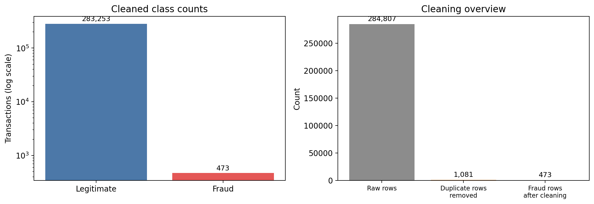
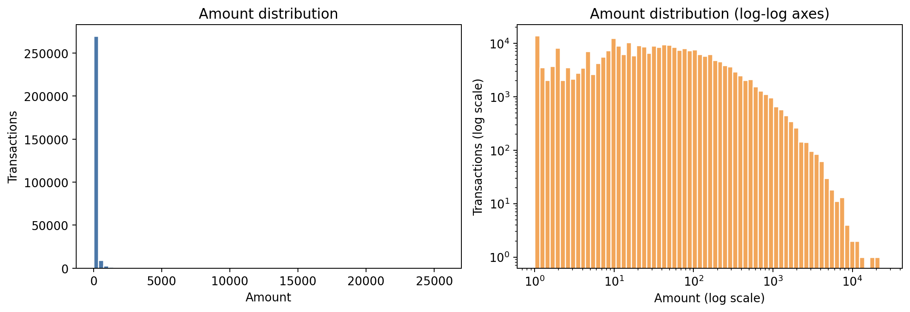
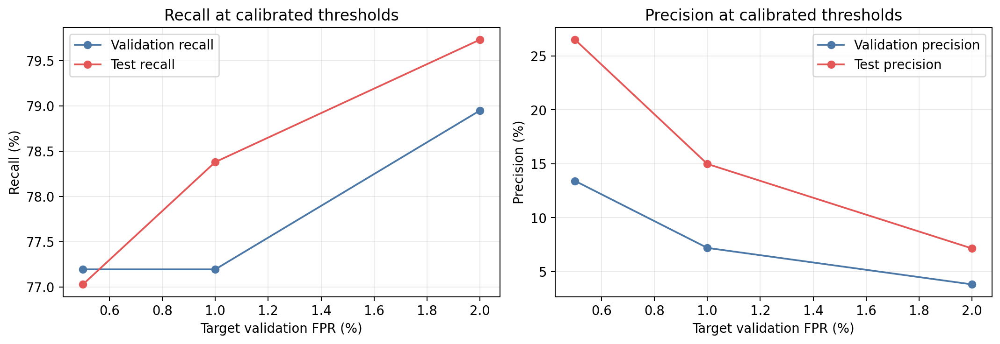

# Card Fraud Triage using Gaussian Mixture Model (GMM) Anomaly Detection

## Abstract

This project develops and evaluates an unsupervised GMM-based anomaly detector for transaction fraud triage. The raw dataset contains 284,807 transactions and 31 columns. After removing 1,081 exact duplicate rows, the cleaned dataset contains 283,726 rows, of which 473 are fraudulent. The dataset is highly imbalanced: fraud represents only 0.1667% of cleaned transactions.

The final GMM uses `V1`–`V28` and `Amount` as inputs. It excludes `Time` from model features and `Class` from training features. Both the standard scaler and the GMM are fitted only on 169,893 legitimate training transactions. A chronological 60/20/20 train, validation, and test split is used to reduce temporal leakage. Validation average precision selects a four-component full-covariance model, and a legitimate-only validation threshold of 69.0386 targets 1% false-positive rate. On the untouched test set, the model achieves 0.5913 Average Precision, 0.9353 ROC-AUC, 78.38% recall, 14.99% precision, and a 0.5805% false-positive rate. It detects 58 of 74 test frauds and generates 329 legitimate false alerts.

These results demonstrate useful anomaly-ranking ability but do not establish production readiness. The low fraud prevalence makes false-alert volume and operational review capacity important. The GMM is therefore presented as an experimental fraud-triage baseline.

## 1. Problem Statement

Transaction monitoring systems must identify uncommon and potentially fraudulent behavior while keeping the number of legitimate alerts manageable. Fraud cases are rare, and a model that flags a large proportion of legitimate transactions can impose substantial manual-review costs.

The project addresses this problem as an unsupervised anomaly-ranking task:

- Learn the normal transaction distribution from legitimate transactions only.
- Assign an anomaly score to each transaction.
- Rank transactions so that suspicious cases receive priority for review.
- Calibrate an alert threshold using legitimate validation transactions.
- Evaluate the final model on a later chronological test period that is not used for model or threshold selection.

Fraud labels are not used to fit the scaler or GMM. Labels are used only to select legitimate training rows and to evaluate the model.

## 2. Objectives

1. Inspect and validate the raw fraud dataset without modifying the source file.
2. Produce a clean, chronologically ordered dataset with documented quality rules.
3. Explore class imbalance, transaction amount, elapsed time, and feature associations.
4. Compare GMM configurations using chronological validation and leakage-safe fitting.
5. Preserve the best legitimate-only GMM and its preprocessing configuration.
6. Calibrate thresholds against validation false-positive rate targets.
7. Evaluate final metrics on an untouched chronological test set.
8. Document limitations and future model-monitoring needs without overstating performance.

## 3. Dataset Overview

The dataset is the Kaggle Credit Card Fraud Detection dataset distributed as `data/raw/creditcard.csv`. It contains 284,807 rows and 31 columns. Elapsed time is recorded as `Time`; transaction amount is `Amount`; `V1`–`V28` are anonymized PCA-style features; and `Class` indicates legitimate (0) or fraud (1).

| Item | Raw data | Cleaned data |
|---|---:|---:|
| Rows | 284,807 | 283,726 |
| Columns | 31 | 31 |
| Missing cells | 0 | 0 |
| Exact duplicate rows | 1,081 | 0 |
| Legitimate transactions | 284,315 | 283,253 |
| Fraud transactions | 492 | 473 |
| Fraud prevalence | 0.1727% | 0.1667% |

The cleaned dataset is not perfectly class-balanced, but its class ratio is a limitation that is useful for anomaly detection: each legitimate transaction is approximately 599 times more common than each fraud transaction.

## 4. Data Extraction and Cleaning

### 4.1 Data Extraction

The extraction notebook validates that all required columns are present and numeric. It inspects shape, a sample of rows, data types, memory use, descriptive statistics, class counts, elapsed-time range, amount distribution, missing values, and exact duplicate rows. The raw file is read-only and is not changed by this stage.

The raw `Time` range is 0 to 172,792 seconds, or approximately 48 hours. `Amount` is strongly right-skewed, with a median of 22.00 and a 99th percentile of 1,018.97. The distribution is more clearly visible with a logarithmic axis.

### 4.2 Cleaning Rules

The cleaning notebook applies only two row-quality rules:

1. Convert infinite numeric values to missing values and remove affected rows.
2. Remove extra copies of exact duplicate rows while retaining the first copy.

No rows contained missing or infinite values. Therefore, 1,081 exact duplicate rows were removed. These included 19 fraud-labeled rows and 1,062 legitimate rows. This leaves 473 frauds, rather than the 492 frauds in the raw file.

The cleaned file keeps `Time`, sorts rows by ascending `Time`, resets the index, and preserves all original columns. It does not scale values, apply a log transform, encode categories, or create engineered features. Scaling is deferred to the GMM pipeline and is fitted only on legitimate training rows.

### 4.3 Cleaning Verification

The cleaned data passed checks for:

- No missing or infinite values.
- No exact duplicate rows.
- Ascending `Time`.
- Only class labels 0 and 1.
- Non-negative `Amount`.
- The original 31-column schema.

The final cleaned file is `data/processed/creditcard_clean.csv`, and the audit is stored in `artifacts/clean_report.json`.

## 5. Exploratory Data Analysis

EDA describes the cleaned dataset and does not alter the GMM configuration or data split.

### 5.1 Class Imbalance

Fraud accounts for 473 of 283,726 cleaned transactions, or 0.1667%. Accuracy is therefore not a primary success metric: a model could label every transaction legitimate and still appear highly accurate while detecting no fraud.

### 5.2 Amount Distribution

The median transaction amount is 22.00, the 75th percentile is 77.51, and the 99.9th percentile is 3,004.75. The amount distribution has a long right tail. The GMM baseline does not apply a log transformation because the project preserves the original amount-based configuration.

### 5.3 Feature Associations

The strongest absolute Spearman correlations with `Class` are modest individually:

| Rank | Feature | Spearman correlation |
|---|---|---:|
| 1 | V14 | -0.0632 |
| 2 | V4 | 0.0617 |
| 3 | V12 | -0.0614 |
| 4 | V11 | 0.0586 |
| 5 | V10 | -0.0580 |

The features are anonymized PCA components. Individual correlations are weak because the GMM uses their combined multivariate distribution rather than a simple univariate threshold. EDA is diagnostic; it does not select features by test-set performance.

## 6. Methodology

### 6.1 Chronological Data Split

The cleaned dataset is ordered by elapsed `Time` and divided into an approximately 60/20/20 split:

| Partition | Rows | Legitimate | Fraud | Elapsed time range |
|---|---:|---:|---:|---|
| Train | 170,235 | 169,893 | 342 | 0–120,392 s |
| Validation | 56,745 | 56,688 | 57 | 120,393–145,233 s |
| Test | 56,746 | 56,672 | 74 | 145,234–172,792 s |

The partitions do not overlap. Transactions with the same elapsed `Time` are kept together. The validation period is later than training, and the test period is later than validation.

### 6.2 Preprocessing

The final model uses `V1`–`V28` and `Amount`, excluding elapsed `Time` and the `Class` label. A standard scaler is fitted only on the 169,893 legitimate training rows. The scaler is not refitted on validation or test data. The GMM is also trained only on legitimate transactions.

Training fraud is excluded deliberately. Including fraud during GMM fitting changes the learned density and was tested as a separate comparison only. In that comparison, the mixed-data GMM achieved validation average precision of approximately 0.1705, compared with 0.7108 for the saved legitimate-only model. It was not retained as the final model.

### 6.3 Model Logic

A GMM represents legitimate transaction behavior as a weighted mixture of multivariate Gaussian distributions. Each transaction receives a negative log-likelihood score:

- Low score: more consistent with the learned legitimate distribution.
- High score: less consistent and therefore more anomalous.
- Transactions above the calibrated threshold are alerted for review.

The saved model uses:

| Parameter | Value |
|---|---|
| Components | 4 |
| Covariance type | Full |
| Initialization count | 1 |
| Maximum iterations | 150 |
| Regularization | 1 × 10⁻⁶ |
| Random seed | 42 |
| Model features | `V1`–`V28`, `Amount` |

The final model and scaler are preserved in `artifacts/gmm_model.joblib`. The accompanying report is `artifacts/gmm_report.json`.

## 7. GMM Training and Model Selection

### 7.1 Component and Covariance Search

The experiment compared covariance structures and component counts under a configured compute budget. Covariance families were `diag`, `full`, `spherical`, and `tied`. The full-covariance grid contained 1, 2, 4, and 8 components.

AIC and BIC were recorded as density-fit diagnostics. They were not used as proof of the true number of fraud clusters. At several grid boundaries, the information criterion continued improving, so the component count was not interpreted as globally optimal.

The model-selection rule was the highest validation average precision among converged candidates.

| Feature configuration | Winning covariance | Components | Validation AP | Validation ROC-AUC |
|---|---|---:|---:|---:|
| With `Time` | Full | 8 | 0.6522 | 0.9257 |
| Without `Time` | Full | 4 | 0.7108 | 0.9475 |

Excluding `Time` produced the better validation Average Precision. `Time` remains in the dataset for chronological splitting and temporal analysis, but is not an input feature in the selected model.

### 7.2 Selected Configuration

The chosen configuration was four full-covariance components without `Time`. This selection used validation labels only. The test set was not used to compare configurations or choose the threshold.

### 7.3 Seed Stability

The implementation also evaluated the selected configuration across seeds 42–46. The mean Spearman correlation with the seed-42 score rankings was 0.9145, and the mean alert-set Jaccard similarity was 0.8673. Thresholds varied from 68.6732 to 79.8257 even though all seeds retained the same 1% validation target.

This indicates meaningful initialization sensitivity. The project therefore preserves seed 42 and its reproducible artifact rather than averaging or replacing the model without new validation evidence.

## 8. Threshold Calibration

The operating threshold is a quantile of negative log-likelihood scores on legitimate validation transactions:

\[
threshold = Quantile_{1-targetFPR}(legitimateValidationScores)
\]

Three target false-positive rates were compared using validation data: 0.5%, 1%, and 2%.

| Target validation FPR | Threshold | Validation precision | Validation recall | Validation FPR |
|---:|---:|---:|---:|---:|
| 0.5% | 87.2618 | 13.41% | 77.19% | 0.5010% |
| 1.0% | 69.0386 | 7.20% | 77.19% | 1.0002% |
| 2.0% | 58.1735 | 3.82% | 78.95% | 2.0004% |

The 1% target was selected as the configured reference operating point. It produced 44 detected validation frauds and 567 legitimate alerts from 56,745 validation transactions. It was not selected because test performance was favorable.

For the later test period, the same threshold yielded a lower observed false-positive rate of 0.5805%. This is evidence of chronological score-distribution drift, not a guarantee that future periods will produce the target FPR.

## 9. Evaluation Metrics and Results

### 9.1 Metric Interpretation

- **Average Precision (AP)**: summarizes precision across recall levels. It is preferred when fraud is rare because it emphasizes whether high-ranked anomalies contain fraud.
- **Precision**: among alerted transactions, the proportion that are actually fraudulent. Low precision means excessive manual-review effort.
- **Recall**: among actual frauds, the proportion detected. Low recall means missed fraud.
- **F1-score**: balances precision and recall, but can still hide the absolute alert burden.
- **ROC-AUC**: measures ranking ability across all thresholds. It can appear optimistic in a highly imbalanced dataset and is therefore secondary to precision-recall metrics.
- **False-positive rate**: the proportion of legitimate transactions incorrectly alerted. This is directly related to review volume.
- **Specificity**: the proportion of legitimate transactions not alerted.

### 9.2 Final Test Metrics

The test set was evaluated only after model selection and threshold calibration were complete.

| Metric | Validation | Test |
|---|---:|---:|
| Rows | 56,745 | 56,746 |
| Fraud cases | 57 | 74 |
| Average Precision | 0.7108 | 0.5913 |
| ROC-AUC | 0.9475 | 0.9353 |
| Precision | 7.20% | 14.99% |
| Recall | 77.19% | 78.38% |
| F1-score | 13.17% | 25.16% |
| False-positive rate | 1.0002% | 0.5805% |
| Legitimate alerts | 567 | 329 |

The test confusion matrix is:

|  | Predicted legitimate | Predicted fraud |
|---|---:|---:|
| Actual legitimate | 56,343 | 329 |
| Actual fraud | 16 | 58 |

The test specificity is 99.4195%. The model missed 16 of 74 test frauds and flagged 329 legitimate transactions. Although recall is 78.38%, only 14.99% of the 387 alerts are actual fraud.

### 9.3 Fixed-Review-Capacity Results

Precision at a fixed review capacity shows the effect of ranking by anomaly score:

| Review capacity | Test frauds detected | Test precision@K | Test recall@K |
|---:|---:|---:|---:|
| 100 | 56 | 56.00% | 75.68% |
| 500 | 58 | 11.60% | 78.38% |
| 1,000 | 60 | 6.00% | 81.08% |

A capacity of 100 captures 56 test frauds, but the final fixed-threshold approach alerts 387 transactions. A review capacity of 1,000 captures 60 frauds but also includes 940 legitimate transactions. Thus, fraud detection must be balanced against the available manual-review budget.

### 9.4 Threshold Sensitivity

The 0.5%, 1%, and 2% validation thresholds produce the following test trade-offs:

| Validation target FPR | Test FPR | Test precision | Test recall | Test alerts |
|---:|---:|---:|---:|---:|
| 0.5% | 0.2788% | 26.51% | 77.03% | 215 |
| 1.0% | 0.5805% | 14.99% | 78.38% | 387 |
| 2.0% | 1.3516% | 7.15% | 79.73% | 825 |

Lower thresholds reduce false alerts but still miss more fraud. The 1% operating point is a provisional reference, not an automatically appropriate production policy.

## 10. Limitations

1. **Rare-fraud uncertainty:** The test set contains only 74 fraud cases. One chronological holdout may not represent future fraud patterns, and bootstrap confidence intervals have not been added.
2. **Score and threshold drift:** The 1% validation target resulted in a 0.5805% test FPR. Future legitimate behavior may shift the score distribution.
3. **Seed sensitivity:** Thresholds and anomaly rankings vary across seeds. The score Spearman correlation and alert Jaccard overlap are moderate but not identical.
4. **Small component search:** AIC/BIC continue improving near some grid boundaries. The chosen component count is the best result within a finite search budget, not a proven true count.
5. **No production review cost supplied:** The 1% FPR target does not account for the monetary cost of missed fraud or the manual cost of false alerts.
6. **Anomaly detector, not calibrated fraud probability:** GMM negative log-likelihood is an ordering score. It should not be interpreted as a calibrated probability of fraud.
7. **Duplicate removal:** Removing exact duplicates also removed 19 fraud-labeled examples. The cleaned dataset records this consequence explicitly.
8. **Limited model comparison:** The project documents a mixed-label GMM comparison but does not implement a supervised classifier or a second anomaly-detection baseline such as Isolation Forest.

## 11. Future Improvements

### 11.1 Demonstrated next experiments

- Validate model selection with chronological cross-validation folds rather than one validation window.
- Compare candidate models using precision-recall, recall at fixed FPR, precision@K, and recall@K.
- Refit the amount distribution with a non-leakage-safe `log1p` experiment only if validation evidence supports it.
- Add bootstrap confidence intervals for AP, precision, recall, and F1 while explaining the limits of a small fraud sample.
- Compare a five-GMM ensemble with the selected single model and retain it only if stability or validation performance improves.
- Add an Isolation Forest baseline using the same data partitions and preprocessing assumptions.

### 11.2 Operational Improvements

- Monitor anomaly-score quantiles and false-positive rates over time.
- Calculate labeled performance when fraud outcomes become available.
- Recalibrate thresholds using later legitimate transactions and explicit review-capacity constraints.
- Version and test replacement artifacts before deployment.
- Record input-validation failures, scoring latency, alert volume, and score drift.
- Define cost-based thresholds using the cost of missed fraud and the cost of manual review.

These improvements are future work. They do not alter the reported results in this project.

## 12. Conclusion

The project completes a leakage-conscious GMM anomaly-detection baseline using a cleaned, chronologically ordered credit-card transaction dataset. The cleaned dataset contains 283,726 rows and 473 fraud cases. The final model uses four full-covariance components and excludes elapsed time and class labels from training features. The scaler and GMM are fitted only on 169,893 legitimate training transactions.

Validation average precision selected the final configuration, while legitimate validation scores calibrated a 1% false-positive threshold. On the untouched test set, the model achieved 0.5913 Average Precision, 78.38% recall, 14.99% precision, and 0.9353 ROC-AUC. It detected 58 of 74 test frauds and generated 329 legitimate false alerts.

The model demonstrates meaningful anomaly-ranking ability and a clear balance among recall, precision, and false-alert cost. However, seed sensitivity, chronological drift, rare-fraud uncertainty, and substantial false-alert volume prevent a claim of production readiness. The current artifact should be treated as an auditable experimental baseline for further fraud-triage research and operational review-cost analysis.
