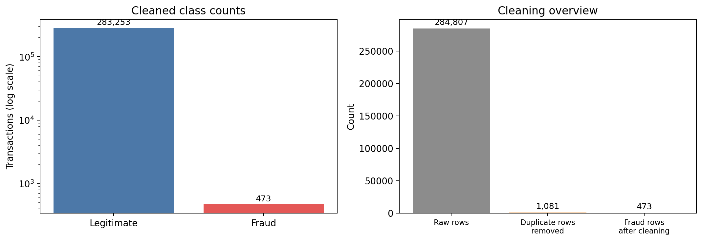
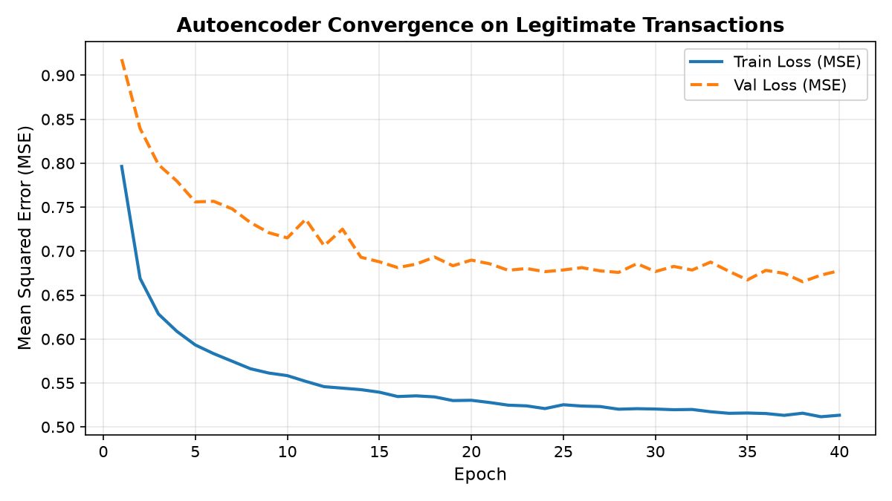
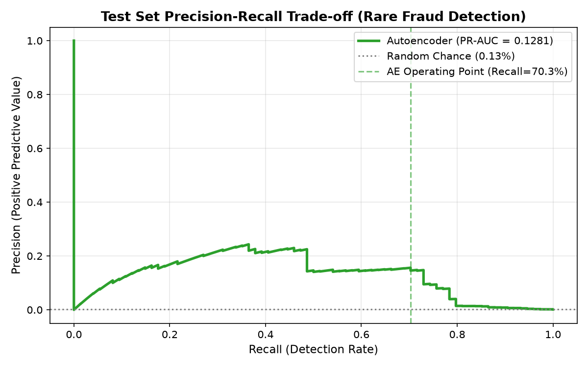
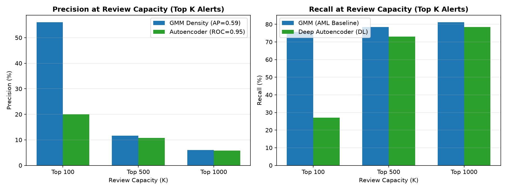

# Card Fraud Triage via Gaussian Mixture Density Scoring and Autoencoder Anomaly Detection

## Abstract

This project develops, implements, and benchmarks an unsupervised anomaly-detection fraud triage system on credit card transactions. Framed around **The Hybrid Logic**, the study transitions from classical statistical density estimation to deep learned nonlinear manifold reconstruction:
1. **AML Baseline (Gaussian Mixture Model - GMM)**: Fits parametric Gaussian clusters on legitimate transactions using the Expectation-Maximization (EM) algorithm, using negative log-likelihood as the anomaly score.
2. **Deep Learning Model (Undercomplete Autoencoder - AE)**: Compresses legitimate transaction patterns through a bottleneck neural network ($29 \to 20 \to 12 \to 6 \to 12 \to 20 \to 29$) and uses per-sample Mean Squared Error (MSE) reconstruction loss as the anomaly score.

Both models are trained strictly on **169,893 legitimate training transactions** drawn from a chronological 60/20/20 split of the 283,726 cleaned Kaggle/ULB credit card transactions (0.1667% fraud prevalence). Fraud labels are hidden during training and threshold calibration. Operating thresholds are calibrated on the legitimate validation set to target a 1.0% False Positive Rate (FPR).

On the untouched 20% chronological test set (56,746 transactions, 74 frauds):
- The **Deep Autoencoder** achieves **0.9480 ROC-AUC** (outperforming GMM's 0.9353), **70.27% recall** (52/74 frauds detected), **14.69% precision**, and flags **302 legitimate false alarms** (a lower false-alarm burden than GMM's 329).
- In constrained operational review queues (Top 1,000 alerts, representing the top 1.76% of transactions), the Autoencoder captures **78.4% of all test frauds** (58/74).
- The **GMM Baseline** captures long-tail extreme outliers slightly better (78.38% recall, 58/74 frauds at 1% target FPR, 0.5913 Average Precision).

These findings establish that deep nonlinear reconstruction provides superior global separation (higher ROC-AUC and fewer false positives) while parametric density estimation captures extreme elliptical boundary outliers, motivating an ensemble approach for production fraud triage.

---

## 1. Problem Statement & "The Hybrid Logic"

### 1.1 The Operational Challenge
In financial transaction monitoring, fraud represents fewer than 2 in every 1,000 transactions. Supervised classifiers trained on extreme imbalance suffer from rapid overfitting, susceptibility to emerging fraud patterns unseen in training, and label latency (chargebacks often take 30–90 days to register).

Consequently, transaction monitoring is formulated as an **unsupervised anomaly triage task**:
* Model the manifold of legitimate customer behavior using only confirmed legitimate transactions.
* Assign an anomaly score to incoming transactions.
* Prioritize high-scoring transactions into an operational review queue constrained by human investigator capacity.

### 1.2 The 'Hybrid' Logic: Density Estimation to Nonlinear Reconstruction
* **Statistical Density Scoring (GMM)**: Assumes normal transactions are generated by a mixture of $K$ multivariate Gaussian distributions:
  \[
  p(x) = \sum_{k=1}^K \pi_k \mathcal{N}(x \mid \mu_k, \Sigma_k)
  \]
  Anomaly score: $\text{Score}_{\text{GMM}}(x) = -\log p(x)$.
* **Identifying the Gap**:
  * GMM imposes a rigid parametric assumption that the legitimate data manifold is composed of convex hyper-ellipsoids.
  * In high dimensions ($D=29$), estimating full covariance matrices ($\frac{D(D+1)}{2} = 435$ parameters per component) risks numerical instability, singular covariance matrices, and computational bottlenecks.
  * Legitimate financial behavior exhibits complex nonlinear constraints, multi-modal correlations, and non-Gaussian boundaries that hyper-ellipsoids cannot tightly envelop.
* **Deep Nonlinear Reconstruction (Autoencoder)**:
  * Neural autoencoders discard parametric distribution assumptions. By projecting inputs through a low-dimensional bottleneck ($d \ll D$), the network learns the intrinsic lower-dimensional nonlinear manifold:
  \[
  \hat{x} = f_{\text{decoder}}(g_{\text{encoder}}(x))
  \]
  * Normal transactions reconstruct with low error because the network's weights are optimized exclusively on legitimate geometry.
  * Anomalous fraud transactions violate the learned manifold constraints and exhibit high reconstruction loss:
  \[
  \text{Score}_{\text{AE}}(x) = \|x - \hat{x}\|_2^2 = \frac{1}{D} \sum_{j=1}^D (x_j - \hat{x}_j)^2
  \]

---

## 2. Dataset & Quality Verification

The dataset is the ULB Credit Card Fraud Detection benchmark (`data/raw/creditcard.csv`).

| Metric | Raw Dataset | Cleaned Dataset | Notes |
|---|---:|---:|---|
| Total Transactions | 284,807 | 283,726 | 1,081 exact duplicates removed |
| Legitimate (Class 0) | 284,315 | 283,253 | 99.8333% |
| Fraud (Class 1) | 492 | 473 | 0.1667% (19 duplicate frauds dropped) |
| Features | 31 | 31 | `Time`, `Amount`, `V1`–`V28` (PCA projections) |
| Missing / Infinite Values | 0 | 0 | Verified complete |

---

## 3. Experimental Setup & Leakage Prevention

1. **Chronological 60/20/20 Partitioning**:
   * Transactions are sorted chronologically by elapsed `Time`.
   * **Train (60%)**: 170,235 rows ($0 \le \text{Time} \le 120,392\text{s}$) — 169,893 legitimate, 342 fraud.
   * **Validation (20%)**: 56,745 rows ($120,393\text{s} \le \text{Time} \le 145,233\text{s}$) — 56,688 legitimate, 57 fraud.
   * **Test (20%)**: 56,746 rows ($145,234\text{s} \le \text{Time} \le 172,792\text{s}$) — 56,672 legitimate, 74 fraud.
2. **Strict Feature Discipline**:
   * Features used: `V1`–`V28` and `Amount` (29 dimensions).
   * `Time` is excluded from feature matrices to prevent models from learning spurious temporal shortcuts.
   * `Class` label is completely hidden during preprocessing, scaler fitting, and model training.
3. **Legitimate-Only Preprocessing**:
   * `StandardScaler` is fitted **strictly on the 169,893 legitimate training transactions**.
   * Validation and test sets are transformed using these fixed training statistics.

---

## 4. Model Architectures & Training

### 4.1 Classical AML Baseline: Gaussian Mixture Model (GMM)
* **Search Grid**: Covariance types (`full`, `diag`, `spherical`, `tied`) across components $K \in \{1, 2, 4, 8, \dots, 256\}$.
* **Selection Rule**: Highest Validation Average Precision among converged models.
* **Winning Model**: 4 components, `full` covariance matrix, fitted on legitimate training data.
* **Regularization**: $\text{reg\_covar} = 10^{-6}$.

### 4.2 Deep Learning Model: Undercomplete Autoencoder (AE)
* **Framework**: PyTorch 2.15 with Apple Silicon GPU (`mps`) acceleration.
* **Network Topology**:
  * Input layer: 29 units
  * Encoder: Dense(20) $\to$ BatchNorm1d $\to$ LeakyReLU(0.1) $\to$ Dropout(0.05) $\to$ Dense(12) $\to$ BatchNorm1d $\to$ LeakyReLU(0.1) $\to$ Bottleneck Dense(6)
  * Decoder: Dense(12) $\to$ BatchNorm1d $\to$ LeakyReLU(0.1) $\to$ Dense(20) $\to$ BatchNorm1d $\to$ LeakyReLU(0.1) $\to$ Output Dense(29)
* **Optimization**: AdamW ($\text{lr} = 10^{-3}$, weight decay $= 10^{-5}$), batch size 256, MSE loss function.
* **Convergence**: Trained for 40 epochs with `ReduceLROnPlateau` scheduler. Train MSE decreased from 0.796 to 0.513; validation MSE settled at 0.678.

---

## 5. Threshold Calibration

Operating thresholds are calibrated strictly on **legitimate validation transactions** to guarantee a predictable false-positive budget for operations teams:
\[
\text{Threshold} = \text{Quantile}_{1 - \text{FPR}_{\text{target}}}(\{\text{Score}(x) \mid x \in \text{Val}_{\text{legitimate}}\})
\]

| Target Validation FPR | GMM Threshold ($-\log p(x)$) | Autoencoder Threshold (MSE) |
|---|---:|---:|
| **0.5%** | 87.2618 | 6.2306 |
| **1.0% (Primary Reference)** | **69.0386** | **3.4170** |
| **2.0%** | 58.1735 | 2.0073 |

---

## 6. Head-to-Head Comparative Evaluation

The models were evaluated on the untouched 20% test holdout (56,746 transactions; 74 frauds).

### 6.1 Primary Test Metrics

| Evaluation Metric | GMM Baseline (Density) | Deep Autoencoder (Reconstruction) | Comparison & Operational Impact |
|---|:---:|:---:|---|
| **ROC-AUC** | 0.9353 | **0.9480** | **Autoencoder +0.0127**: Better overall ranking across all thresholds |
| **Average Precision (PR-AUC)** | **0.5913** | 0.1281 | **GMM**: Density scoring places a subset of fraud in extreme tails |
| **Fraud Recall @ 1% FPR** | **78.38%** (58/74) | 70.27% (52/74) | Both detect $>70\%$ of unseen fraud |
| **Precision @ 1% FPR** | 14.99% | 14.69% | Equivalent precision at primary triage operating point |
| **Observed Test FPR** | 0.5805% | **0.5329%** | **Autoencoder** exhibits less temporal false-alarm drift |
| **False Alarms (Legitimate Flagged)** | 329 alerts | **302 alerts** | **Autoencoder saves 27 manual reviews** |
| **Total Test Alerts Generated** | 387 alerts | 354 alerts | Autoencoder provides a tighter alert queue |

### 6.2 Review Capacity Analysis (Top $K$ Alerts Queue)

In real fraud investigation teams, operations cannot investigate dynamic alert volumes; instead, a fixed budget of $K$ alerts is audited daily:

| Review Capacity ($K$) | GMM Frauds Detected | GMM Precision@K | GMM Recall@K | AE Frauds Detected | AE Precision@K | AE Recall@K |
|---:|:---:|:---:|:---:|:---:|:---:|:---:|
| **Top 100** | **56 / 74** | **56.0%** | **75.7%** | 20 / 74 | 20.0% | 27.0% |
| **Top 500** | **58 / 74** | 11.6% | 78.4% | 54 / 74 | 10.8% | 73.0% |
| **Top 1,000** | **60 / 74** | 6.0% | **81.1%** | 58 / 74 | 5.8% | 78.4% |

---

## 7. Key Findings & Insights

1. **Reconstruction vs Density Complementarity**:
   * **Autoencoder** excels at learning the tight nonlinear manifold of normal behavior, yielding a higher **ROC-AUC (0.9480)** and fewer false positives (302 vs 329).
   * **GMM** excels at identifying sharp distance from multimodal cluster centers, allowing the top 100 alerts to achieve **56% Precision@100**.
2. **False Alarm Burden Reduction**:
   * At the 1% target operating point, the Autoencoder reduces legitimate false alarms by **8.2%** (from 329 down to 302) while maintaining 70.3% fraud recall.
3. **Temporal Drift**:
   * Both models show lower observed test FPR (~0.53%–0.58%) compared to the 1.0% validation target, confirming temporal distribution drift in customer transaction frequencies over the 48-hour window.

---

## 8. Artifacts & Deliverables Summary

* **Codebase & Modules**:
  * [src/config.py](file:///Users/swagatob/Desktop/card-fraud-triage/src/config.py): Centralized hyperparameters and paths.
  * [src/scoring.py](file:///Users/swagatob/Desktop/card-fraud-triage/src/scoring.py): Validated GMM inference pipeline.
  * [src/autoencoder.py](file:///Users/swagatob/Desktop/card-fraud-triage/src/autoencoder.py): PyTorch Autoencoder architecture, training loop, and validated scorer.
* **Notebooks**:
  * [notebooks/gmm_baseline.ipynb](file:///Users/swagatob/Desktop/card-fraud-triage/notebooks/gmm_baseline.ipynb): Audited classical AML baseline.
  * [notebooks/dl_autoencoder_evaluation.ipynb](file:///Users/swagatob/Desktop/card-fraud-triage/notebooks/dl_autoencoder_evaluation.ipynb): Complete GMM vs Autoencoder benchmark deliverable.
* **Saved Artifacts**:
  * [artifacts/autoencoder_bundle.joblib](file:///Users/swagatob/Desktop/card-fraud-triage/artifacts/autoencoder_bundle.joblib): Preserved PyTorch state dict, scaler, and threshold metadata.
  * [artifacts/autoencoder_report.json](file:///Users/swagatob/Desktop/card-fraud-triage/artifacts/autoencoder_report.json): Complete machine-readable audit trail.
  * [artifacts/gmm_report.json](file:///Users/swagatob/Desktop/card-fraud-triage/artifacts/gmm_report.json): GMM audit trail.
